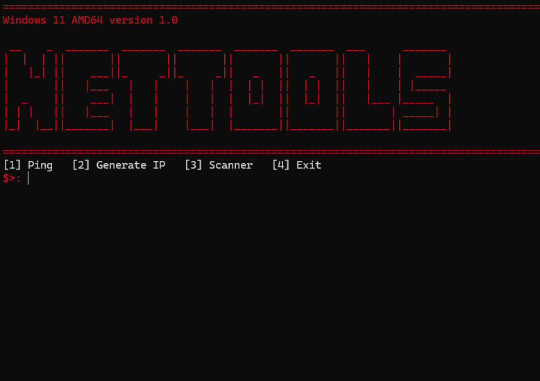

# NETTOOLS

```text
███╗   ██╗███████╗████████╗████████╗ ██████╗  ██████╗ ██╗     ███████╗
████╗  ██║██╔════╝╚══██╔══╝╚══██╔══╝██╔═══██╗██╔═══██╗██║     ██╔════╝
██╔██╗ ██║█████╗     ██║      ██║   ██║   ██║██║   ██║██║     ███████╗
██║╚██╗██║██╔══╝     ██║      ██║   ██║   ██║██║   ██║██║     ╚════██║
██║ ╚████║███████╗   ██║      ██║   ╚██████╔╝╚██████╔╝███████╗███████║
╚═╝  ╚═══╝╚══════╝   ╚═╝      ╚═╝    ╚═════╝  ╚═════╝ ╚══════╝╚══════╝
```

<p align="center">
<b>Network Utility Toolkit</b>
</p>

<p align="center">
Uma ferramenta de terminal desenvolvida em Python para diagnóstico, análise e utilidades de rede.
</p>


## Preview

<p align="center">

</p>


## Sobre o Projeto

**NETTOOLS** é uma ferramenta CLI (**Command Line Interface**) desenvolvida em Python com o objetivo de reunir diversas ferramentas relacionadas a redes em um único programa.

O projeto foi criado para estudos de programação, redes de computadores e automação de tarefas utilizando bibliotecas Python e recursos nativos do sistema operacional.

A ferramenta possui uma estrutura modular, permitindo adicionar novas funcionalidades e receber futuras atualizações.


## Funcionalidades Atuais

### 🌐 HTTP Scanner

Realiza uma análise básica de uma página web utilizando requisições HTTP.

Informações coletadas:

- Código de status HTTP
- Headers da resposta
- Cookies recebidos
- URL final
- Conteúdo HTML da página


### 🌍 IP Generator

Gerador de endereços IPv4 aleatórios utilizando:

- `ipaddress`
- `random`

Criado para auxiliar em estudos relacionados a endereçamento IP.


### 📡 Ping Tool

Ferramenta de teste de conectividade utilizando comandos nativos do sistema operacional.

Compatível com:

- Windows
- Linux


## Próximas Atualizações

O NETTOOLS está em desenvolvimento e novas funções podem ser adicionadas futuramente.

Possíveis recursos:

- Consulta DNS
- Informações de domínio
- Traceroute
- Verificação SSL/TLS
- Mais ferramentas de diagnóstico de rede
- Melhorias no menu principal
- Melhor organização dos módulos
- Otimizações de desempenho


## Tecnologias Utilizadas

Desenvolvido utilizando:

- Python 3
- Requests
- Colorama
- Halo


Bibliotecas nativas:

- OS
- Time
- Platform
- Sys
- Random
- Ipaddress


## Requisitos

Antes de executar:

- Python 3.10 ou superior
- Pip


## Estrutura do Projeto

```text
NETTOOLS/
│
├── main.py
├── requirements.txt
├── README.md
│
├── imgs/
│   └── menu.png
│
└── modules/
    ├── check.py
    ├── scanner.py
    ├── ping.py
    ├── ip_generator.py
    └── clear.py
```


## Instalação

Clone o repositório:

```bash
git clone https://github.com/rafaelkkj123rs/nettools.git
```

Entre na pasta:

```bash
cd nettools
```

Instale as dependências:

```bash
pip install -r requirements.txt
```


## Como Executar

O arquivo principal do NETTOOLS é:

```text
main.py
```

Execute:

### Windows

```bash
python main.py
```

### Linux

```bash
python3 main.py
```


## Compatibilidade

Sistemas suportados:

✅ Windows  
✅ Linux  


## Aviso

Esta ferramenta foi desenvolvida para fins educacionais.

Utilize somente em ambientes próprios ou onde você possui autorização.


## Autor

Desenvolvido por:

**Rafael**

GitHub:

https://github.com/rafaelkkj123rs


## Licença

Projeto em desenvolvimento.
Novas funcionalidades e melhorias podem ser adicionadas futuramente.
